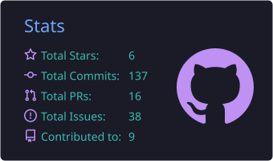
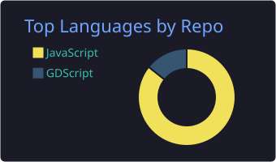

   
  

# Vennjy Lugo 🐱

**3rd Year Computer Science Undergraduate** 

I love making pixel games, machine learning, and AI! I also like contributing to other people's projects to see where I can help even if it's small. I use Arch btw 🐧.

Currently focused on **2D game development with Godot, machine learning with Python, and basic web development using HTML, CSS, JavaScript, Preact, and Vite.**

## Core Skills
- **Languages:** C, C++, JavaScript, Python
- **Frontend:** HTML, CSS, React, Preact, Vite
- **Backend:** Firebase, Supabase
- **Game Dev:** Godot, Aseprite
- **Tools & OS:** Docker, Arch Linux

## Connect

- **Email:** vennjy.lugo@gmail.com
- **GitHub:** https://github.com/Yjnnev
  
> Reach out! 🐾
